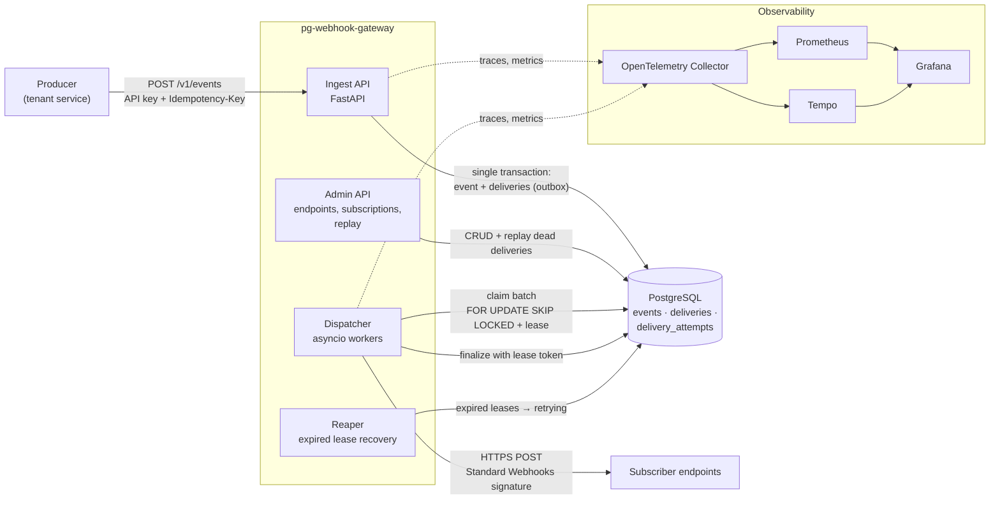

# pg-webhook-gateway

[](https://github.com/dandobjim/pg-webhook-gateway/actions/workflows/ci.yml)
[](https://codecov.io/gh/dandobjim/pg-webhook-gateway)
[](https://www.python.org/downloads/)
[](https://github.com/astral-sh/ruff)
[](https://github.com/astral-sh/uv)
[](LICENSE)

## Overview

Reliable webhook delivery gateway in Python: Postgres-backed queue with SKIP LOCKED leases, at-least-once delivery, Standard Webhooks signatures, retries with jitter, DLQ and replay.

<!-- Describe the problem this project solves, who it is for and how it fits in a bigger system. -->

## Features

<!-- List the main capabilities. Keep each bullet short and user-facing. -->

- Feature one
- Feature two

## Quickstart

Requirements: Python >= 3.14 and [uv](https://docs.astral.sh/uv/).

```bash
git clone https://github.com/dandobjim/pg-webhook-gateway.git
cd pg-webhook-gateway
uv sync
```

```python
import pg_webhook_gateway

print(pg_webhook_gateway.__version__)
```

## Configuration

Project and tool settings live in [`pyproject.toml`](pyproject.toml): dependencies, Ruff, mypy, pytest and coverage.

<!-- Document runtime configuration here. Example: -->

| Variable    | Description             | Default |
| ----------- | ----------------------- | ------- |
| `LOG_LEVEL` | Application log level   | `INFO`  |

## Development

```bash
uv sync                      # create .venv and install the project + dev tools
uv run pre-commit install    # run checks automatically on every commit
```

**Commit `uv.lock`.** CI installs with `--locked`, so it fails if the lockfile is missing or out of sync with `pyproject.toml` (the `uv-lock` pre-commit hook keeps it updated locally).

| Task                     | Command                             |
| ------------------------ | ----------------------------------- |
| Lint                     | `uv run ruff check .`               |
| Lint and autofix         | `uv run ruff check --fix .`         |
| Format                   | `uv run ruff format .`              |
| Type check (strict)      | `uv run mypy`                       |
| Run all pre-commit hooks | `uv run pre-commit run --all-files` |
| Update hook versions     | `uv run pre-commit autoupdate`      |
| Add a dependency         | `uv add <package>`                  |
| Add a dev dependency     | `uv add --dev <package>`            |

See [CONTRIBUTING.md](CONTRIBUTING.md) for branch naming, commit conventions and the PR checklist.

## Testing

| Task                       | Command                           |
| -------------------------- | --------------------------------- |
| Run tests with coverage    | `uv run pytest`                   |
| HTML coverage report       | `uv run pytest --cov-report=html` |
| Run a single test          | `uv run pytest tests/path.py::test_name` |

Tests fail if coverage drops below **80%** (`[tool.coverage.report] fail_under` in `pyproject.toml`).

GitHub Actions runs on every push to `main` and on every pull request:

- **Lint**: all pre-commit hooks (ruff check, ruff format, mypy in strict mode, file hygiene).
- **Test**: `pytest` on every supported Python version (3.14–3.14); coverage is uploaded to [Codecov](https://codecov.io/gh/dandobjim/pg-webhook-gateway).

Actions are pinned to commit SHAs and [Dependabot](.github/dependabot.yml) opens weekly PRs to update actions, Python dependencies and pre-commit hooks.

## Architecture

Significant design decisions are recorded as [Architecture Decision Records](docs/adr/README.md) using the [MADR](https://adr.github.io/madr/) format.

```
pg-webhook-gateway/
├── .github/                # CI workflow, Dependabot, PR template
├── docs/adr/               # architecture decision records
├── src/pg_webhook_gateway/ # package source code
├── tests/                  # pytest test suite
└── pyproject.toml          # metadata, dependencies and tool configuration
```



## Project docs

- [CONTRIBUTING.md](CONTRIBUTING.md): how to set up, branch, commit and open PRs
- [CHANGELOG.md](CHANGELOG.md): notable changes per release
- [SECURITY.md](SECURITY.md): how to report vulnerabilities

This project was generated with [Copier](https://copier.readthedocs.io/). Pull in template updates with `uvx copier update`.

## License

Distributed under the [MIT License](LICENSE). © 2026 Daniel Doblas Jimenez
