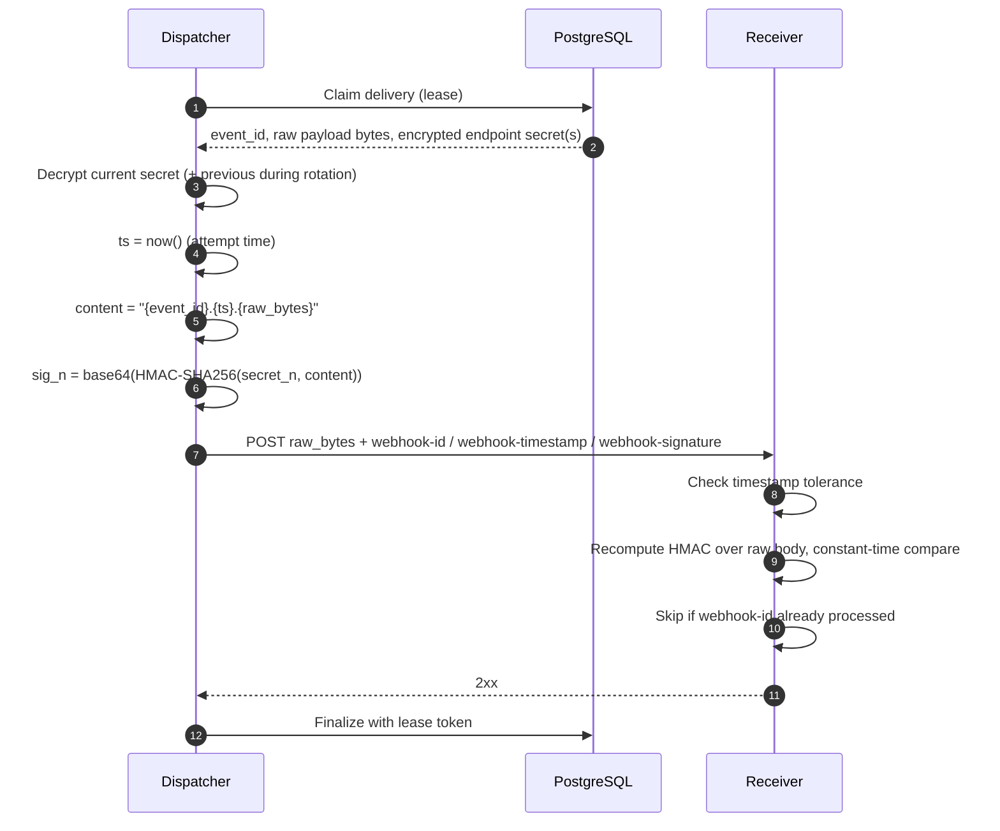

# ADR-0002: Use Standard Webhooks for payload signing

## Context and Problem Statement

`pg-webhook-gateway` delivers events to subscriber endpoints over HTTP. A subscriber
endpoint is a public URL: anyone who learns it can send it a `POST`. Before a receiver
acts on a delivery, it must be able to prove that the request:

| Threat         | Attack                                                                    | Required control                                               |
| -------------- | ------------------------------------------------------------------------- | -------------------------------------------------------------- |
| Spoofing       | Attacker sends a forged `invoice.paid` event                              | Signature with a secret only the gateway and the receiver know |
| Tampering      | Attacker modifies the body in transit or in a proxy                       | Signature covers the exact body bytes                          |
| Replay         | Attacker captures a valid delivery and resends it later                   | Signed attempt timestamp checked against a tolerance window    |
| Duplicates     | The gateway retries (at-least-once, see NFR-1 in `docs/requirements.md`)  | Stable, signed message ID usable as an idempotency key         |
| Timing attack  | Attacker guesses the signature byte by byte                               | Constant-time comparison on the receiver side                  |
| Key compromise | A signing secret leaks                                                    | Rotation without delivery downtime                             |

Signing is not optional. The question this ADR answers is **which signing scheme the
gateway uses**, and therefore which headers, signed content, secret format and
verification rules receivers must implement.

## Decision Drivers

- **Security by default**: replay protection, tamper protection and idempotency must be
  part of the scheme, not left to each receiver.
- **Receiver effort**: receivers should verify with an existing library instead of
  writing custom cryptographic code against our documentation.
- **Zero-downtime key rotation**: rotating a secret must not require both sides to switch
  at the same instant.
- **Forward compatibility**: the scheme must allow adding a new algorithm later without
  breaking existing receivers.
- **Dispatcher hot path cost**: signing runs once per delivery attempt and must be cheap.
- **Scope**: the project has a 16-week budget; complexity must be justified.

## Considered Options

1. Static shared token in a header (`Authorization: Bearer <token>`)
2. Source IP allowlist
3. Mutual TLS (mTLS)
4. Custom HMAC-SHA256 scheme (e.g. `X-Signature: sha256=<hex>`, GitHub style)
5. Standard Webhooks specification v1.0.0

## Decision Outcome

Chosen option: **"Standard Webhooks specification v1.0.0"**, using the **symmetric
`v1` scheme (HMAC-SHA256)** as the only scheme in `v1.0.0`, because it is the only
option that covers every threat in the table above, receivers can verify it with
existing libraries, and it defines rotation and versioning up front.

### Implementation rules

**Headers** sent on every delivery attempt:

```http
webhook-id: <event id>
webhook-timestamp: <unix seconds of this attempt>
webhook-signature: v1,<base64 signature> [v1,<base64 signature> ...]
```

**Signed content** is the literal string:

```text
{webhook-id}.{webhook-timestamp}.{raw body bytes}
```

signed with HMAC-SHA256 under the decoded endpoint secret and base64-encoded.

**Rules derived from the specification:**

| Rule                                                                      | Rationale                                                 | Impact on this project                                                                      |
| ------------------------------------------------------------------------- | --------------------------------------------------------- | ------------------------------------------------------------------------------------------- |
| `webhook-id` is generated by the gateway and is **stable across retries** | Receivers use it as their idempotency key                 | Taken from `events.id`, never from `delivery_attempts.id`; never accepted from the producer |
| `webhook-id` and `webhook-timestamp` must not contain `.`                 | Prevents shifting field boundaries in the signed content  | IDs are UUIDs; timestamp is an integer                                                      |
| `webhook-timestamp` is the **attempt** time, not the event time           | Replay protection must refresh on each retry              | Computed by the dispatcher right before each HTTP call                                      |
| Sign the exact bytes sent                                                 | Re-serialising JSON changes bytes and breaks signatures   | Payload is serialised once at ingest, stored as raw bytes, signed and sent unchanged        |
| One secret per endpoint                                                   | Reusing secrets across customers is a security issue      | Secret column lives on `endpoints`, not on `tenants`                                        |
| Secret format `whsec_` + base64 of 24–64 random bytes                     | Libraries detect the scheme; secret scanners detect leaks | Generate 32 random bytes with `secrets.token_bytes(32)`                                     |
| Space-separated list of signatures                                        | Zero-downtime rotation                                    | During a rotation window the dispatcher signs with the current and the previous secret      |
| Version prefix (`v1`, `v1a`)                                              | Receivers ignore versions they do not understand          | Allows adding asymmetric `v1a` later without breaking receivers                             |

**Receiver verification requirements** (documented in `docs/receiving-webhooks.md`):

1. Verify against the **raw** request body, before any JSON parsing.
2. Reject if `|now - webhook-timestamp|` exceeds the tolerance (5 minutes, the default
   of the official libraries).
3. Compare signatures in constant time; accept if **any** listed `v1` signature matches.
4. Deduplicate on `webhook-id`.

### Delivery signing flow



### Consequences

- Good, because receivers verify with the official Standard Webhooks libraries
  (Python, Node.js, Go, and others) instead of custom code.
- Good, because replay protection, idempotency and zero-downtime rotation are part of
  the scheme by design.
- Good, because the version prefix allows adding asymmetric signatures (`v1a`) per
  endpoint without a breaking change.
- Good, because the specification's guidance on retries, status codes, timeouts and SSRF
  is reused in later decisions (see "More Information").
- Good, because HMAC-SHA256 is fast and widely hardware-accelerated, keeping the
  dispatcher hot path cheap.
- Bad, because endpoint secrets must be stored **reversibly** (encrypted at rest), unlike
  API keys, which are stored as hashes. This requires a key-encryption key outside the
  database.
- Bad, because a symmetric secret is shared: if a receiver leaks it, anyone can forge
  deliveries to that receiver until it is rotated.
- Bad, because receivers must keep their clocks reasonably synchronised and must have
  access to the raw request body, which some frameworks hide by default.
- Neutral, because Standard Webhooks is a community specification (v1.0.0), not an
  IETF or W3C standard.

### Confirmation

This decision is confirmed when:

1. An **interoperability test** in `tests/integration/` signs a delivery with the
   gateway's signer and verifies it with the official
   [`standardwebhooks`](https://pypi.org/project/standardwebhooks/) Python package
   (`from standardwebhooks.webhooks import Webhook`, `Webhook(secret).verify(payload, headers)`).
2. A test proves that a delivery signed with both the current and the previous secret
   verifies with either secret alone.
3. Unit tests prove that a modified body, a modified `webhook-id` and a timestamp outside
   the tolerance all fail verification.
4. A test proves that `webhook-id` is identical across all attempts of the same delivery
   while `webhook-timestamp` changes.

## Pros and Cons of the Options

### Static shared token

- Good, because it is trivial to implement and to verify.
- Bad, because it does not protect the body: a valid token authorises any content.
- Bad, because it offers no replay protection.
- Bad, because the token travels in every request and leaks easily through logs and
  proxies.

### Source IP allowlist

- Good, because corporate receivers often require static source IPs anyway.
- Bad, because it does not protect against tampering or replay.
- Bad, because it ties the deployment to fixed egress IPs.
- Neutral, because it is a complement, not a replacement. It can be offered later
  through a fixed egress proxy.

### Mutual TLS

- Good, because it provides strong transport-level authentication.
- Bad, because it authenticates the **channel**, not the **message**: a payload stored
  and forwarded by an intermediary is no longer covered.
- Bad, because every receiver must issue, install and rotate client certificates, which
  is high friction for a webhook consumer.
- Bad, because it adds no idempotency key.

### Custom HMAC-SHA256 scheme

- Good, because it uses the same cryptography as the chosen option.
- Good, because it gives full control over header names and format.
- Bad, because every receiver must write verification code against our documentation.
- Bad, because the details that usually break (signed timestamp, signed ID, field
  delimiters, rotation, versioning) must be designed and reviewed from scratch.
- Bad, because it adds to the ecosystem fragmentation that Standard Webhooks addresses.

### Standard Webhooks v1.0.0

- Good, because it covers spoofing, tampering, replay, duplicates and rotation by design.
- Good, because official libraries exist for receivers and are used by real providers
  (Svix, Resend, Clerk, Zapier).
- Good, because it defines both symmetric (`v1`, HMAC-SHA256) and asymmetric
  (`v1a`, Ed25519) schemes behind a version prefix.
- Neutral, because the specification itself recommends preferring asymmetric
  signatures; choosing `v1` is a conscious trade-off (see below).
- Bad, because it constrains header names and secret format to the specification.

## More Information

### Why symmetric (`v1`) and not asymmetric (`v1a`) first

The specification recommends asymmetric signatures when the producer does not control
the security of the consumer, because the consumer only needs a public, non-secret key.
`v1` is still chosen for `v1.0.0` because:

- it is the scheme every receiver library supports first;
- it has the lowest cost per attempt in the dispatcher hot path;
- it keeps key management simple within the project's time budget.

**Follow-up:** add optional per-endpoint `v1a` (Ed25519) support after `v1.0.0`. The
version prefix makes this a non-breaking change. Track it as an issue linked to this ADR.

### Guidance reused in other decisions

| Topic             | Specification guidance                                                                                                                  | Where it applies                 |
| ----------------- | --------------------------------------------------------------------------------------------------------------------------------------- | -------------------------------- |
| Payload shape     | `type`, `timestamp`, `data`; dot-delimited hierarchical event types                                                                     | Ingest API (step 3)              |
| Payload size      | Keep payloads small, usually under 20 KB                                                                                                | Ingest validation (step 3)       |
| Retries           | Exponential backoff with jitter over several days                                                                                       | Dispatcher retry policy (step 4) |
| Status codes      | Only `2xx` is success; `3xx` is failure (no redirects); `410` disables the endpoint; `429`, `502`, `504` throttle; honour `Retry-After` | Dispatcher (step 4)              |
| Timeouts          | 15–30 s per request                                                                                                                     | Dispatcher HTTP client (step 4)  |
| SSRF              | Egress proxy filtering internal IPs; workers in an isolated subnet                                                                      | Security (step 5)                |
| Failing endpoints | Notify through another channel and disable the endpoint                                                                                 | Resilience (step 6)              |

### References

- [Standard Webhooks specification v1.0.0](https://github.com/standard-webhooks/standard-webhooks/blob/main/spec/standard-webhooks.md)
- [Standard Webhooks website](https://www.standardwebhooks.com)
- [`standardwebhooks` on PyPI](https://pypi.org/project/standardwebhooks/)
- [OWASP API Security Top 10 2023, API7: Server Side Request Forgery](https://owasp.org/API-Security/editions/2023/en/0xa7-server-side-request-forgery/)
- Related: [ADR-0001](0001-postgres-vs-redis-kafka.md) (queue technology)
