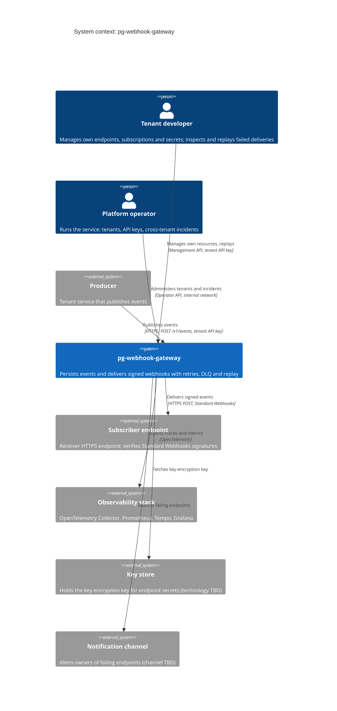

# Requirements

Functional (FR) and non-functional (NFR) requirements for `pg-webhook-gateway`.
Each requirement has a stable ID so ADRs, issues and tests can reference it.
Items marked **TBD** are open and must be decided before the step that needs them.

## Scope

A reliable webhook delivery gateway. Producers (tenant services) publish events
through an HTTP API; the gateway persists them in PostgreSQL and delivers them to
subscriber endpoints with signatures, retries, a dead-letter queue and replay.

Administration is split into two APIs with different audiences, permissions and risk:

|            | Management API (tenant)                          | Operator API (platform)                                   |
| ---------- | ------------------------------------------------ | --------------------------------------------------------- |
| Who        | The customer that publishes events               | The operator of the service                               |
| Scope      | Only its own resources (`tenant_id` of the key)  | All tenants                                               |
| Auth       | Tenant API key (`Bearer hk_live_…`)              | Separate credential (operator token or OIDC), never a tenant API key |
| Exposure   | Public, next to ingest                           | Internal network, separate port or ingress                |
| Prefix     | `/v1/...`                                        | `/internal/v1/...` or a separate service (TBD)            |

### System context (C4 level 1)

PostgreSQL is part of the gateway (it is the queue, see ADR-0001), so it lives inside
the system boundary and appears only at the container level.

| Element              | Requirements                 |
| -------------------- | ---------------------------- |
| Producer             | FR-1 to FR-6                 |
| Tenant developer     | FR-7 to FR-11, NFR-11, NFR-12 |
| Platform operator    | FR-12 to FR-16, NFR-13, NFR-14 |
| Subscriber endpoint  | FR-19 to FR-25, NFR-9        |
| Observability stack  | NFR-16 to NFR-18             |
| Key store            | NFR-6                        |
| Notification channel | FR-26                        |

Out of scope for `v1.0.0`: TBD.

## Functional requirements

### Ingest

| ID     | Requirement                                                                                                           | Source         |
| ------ | --------------------------------------------------------------------------------------------------------------------- | -------------- |
| FR-1   | Producers publish events with `POST /v1/events`, authenticated with an API key.                                       | README         |
| FR-2   | Ingest accepts an `Idempotency-Key` header; repeating a request with the same key does not create a duplicate event. | README         |
| FR-3   | The event and its deliveries (one per matching subscription) are stored in a single transaction (outbox).             | README         |
| FR-4   | Payloads follow the shape `type`, `timestamp`, `data`, with dot-delimited hierarchical event types.                   | ADR-0002       |
| FR-5   | Payloads above the size limit are rejected (target: under 20 KB; exact limit TBD).                                    | ADR-0002       |
| FR-6   | The payload is serialised once at ingest and stored as raw bytes; it is never re-serialised before delivery.          | ADR-0002       |

### Management API (tenant)

Standard Webhooks recommends giving consumers an API to manage endpoints, a way to
list failed messages with their failure reasons, and manual replay. Without it, every
customer incident becomes a support ticket for the operator.

| ID     | Requirement                                                                                                                              | Source                     |
| ------ | ---------------------------------------------------------------------------------------------------------------------------------------- | -------------------------- |
| FR-7   | CRUD of the tenant's endpoints and subscriptions.                                                                                        | Standard Webhooks, README  |
| FR-8   | Rotate the signing secret of an endpoint.                                                                                                | ADR-0002                   |
| FR-9   | Inspect events, dead deliveries and attempt history (`GET /v1/events/{id}`, `GET /v1/deliveries?status=dead`, `delivery_attempts` with failure reasons). | Standard Webhooks |
| FR-10  | Replay a single dead delivery (`POST /v1/deliveries/{id}/replay`) and bulk-replay the tenant's dead deliveries.                          | Standard Webhooks, README  |
| FR-11  | Re-enable an endpoint that the gateway disabled automatically.                                                                           | Decision (not covered by the spec) |

### Operator API (platform)

| ID     | Requirement                                                                                          | Source   |
| ------ | ---------------------------------------------------------------------------------------------------- | -------- |
| FR-12  | Create and delete tenants; issue and revoke tenant API keys.                                         | Decision |
| FR-13  | Suspend a tenant (abuse, non-payment).                                                               | Decision |
| FR-14  | Replay or purge deliveries across tenants after a platform incident (for example a dispatcher bug).  | Decision |
| FR-15  | Force-disable any endpoint (abuse, SSRF target).                                                     | Decision |
| FR-16  | Diagnostics: circuit breaker state per endpoint and stuck leases.                                    | Decision |

### Delivery

| ID     | Requirement                                                                                                                       | Source             |
| ------ | --------------------------------------------------------------------------------------------------------------------------------- | ------------------ |
| FR-17  | Dispatcher workers claim deliveries in batches with `FOR UPDATE SKIP LOCKED` and a lease; a worker finalises only with its lease token. | README, ADR-0001 |
| FR-18  | A reaper returns deliveries with expired leases to `retrying`.                                                                    | README             |
| FR-19  | Every delivery is signed with Standard Webhooks v1.0.0 (`v1`, HMAC-SHA256).                                                       | ADR-0002           |
| FR-20  | Only `2xx` responses count as success; `3xx` is a failure (redirects are not followed).                                           | ADR-0002           |
| FR-21  | `410 Gone` disables the endpoint.                                                                                                 | ADR-0002           |
| FR-22  | `429`, `502` and `504` throttle the endpoint, honouring `Retry-After`.                                                            | ADR-0002           |
| FR-23  | Failed deliveries are retried with exponential backoff and jitter over several days (exact schedule TBD).                         | README, ADR-0002   |
| FR-24  | Deliveries that exhaust their retries move to the dead-letter queue.                                                              | README             |
| FR-25  | Every attempt is recorded in `delivery_attempts`.                                                                                 | README             |
| FR-26  | Persistently failing endpoints are disabled and their owner is notified through another channel (channel TBD).                    | ADR-0002           |

## Non-functional requirements

### Reliability

| ID     | Requirement                                                                                                         | Source           |
| ------ | ------------------------------------------------------------------------------------------------------------------- | ---------------- |
| NFR-1  | **At-least-once delivery**: an accepted event is delivered at least once or ends in the DLQ; it is never silently lost. | README, ADR-0001 |
| NFR-2  | No global ordering guarantee; receivers must be idempotent and deduplicate on `webhook-id`.                          | ADR-0001, ADR-0002 |
| NFR-3  | PostgreSQL is the only stateful dependency (no Redis or Kafka).                                                      | ADR-0001         |
| NFR-4  | Delivery throughput and latency targets: TBD.                                                                        | —                |

### Security

| ID     | Requirement                                                                                                     | Source   |
| ------ | --------------------------------------------------------------------------------------------------------------- | -------- |
| NFR-5  | One signing secret per endpoint, format `whsec_` + base64 of random bytes.                                      | ADR-0002 |
| NFR-6  | Endpoint secrets are encrypted at rest with a key-encryption key stored outside the database.                   | ADR-0002 |
| NFR-7  | API keys are stored as hashes, never in plain text.                                                             | ADR-0002 |
| NFR-8  | Secret rotation causes no delivery downtime (current and previous secret both sign during the rotation window). | ADR-0002 |
| NFR-9  | Outbound requests are protected against SSRF (egress proxy filtering internal IPs, isolated worker subnet).     | ADR-0002 |
| NFR-10 | Deliveries use HTTPS.                                                                                           | README   |
| NFR-11 | Tenant isolation: the Ingest and Management APIs only read and modify resources of the `tenant_id` bound to the API key. | Decision |
| NFR-12 | Ingest and Management APIs authenticate with the tenant API key (`Bearer hk_live_…`).                           | Decision |
| NFR-13 | The Operator API uses a separate credential (operator token or OIDC; TBD) and always rejects tenant API keys.   | Decision |
| NFR-14 | The Operator API is not publicly exposed: internal network, separate port or ingress.                           | Decision |

### Performance

| ID     | Requirement                                                      | Source   |
| ------ | ---------------------------------------------------------------- | -------- |
| NFR-15 | Outbound HTTP requests time out after 15–30 s (exact value TBD). | ADR-0002 |

### Observability

| ID     | Requirement                                                                                         | Source |
| ------ | --------------------------------------------------------------------------------------------------- | ------ |
| NFR-16 | The Ingest API and the dispatcher export traces and metrics through OpenTelemetry.                  | README |
| NFR-17 | Metrics are scraped by Prometheus, traces stored in Tempo, both visualised in Grafana.              | README |
| NFR-18 | Required metrics, SLIs and alerts: TBD.                                                             | —      |

### Quality

| ID     | Requirement                                                                 | Source        |
| ------ | --------------------------------------------------------------------------- | ------------- |
| NFR-19 | Python 3.14+, type-checked with mypy in strict mode, linted with Ruff.      | README        |
| NFR-20 | Test coverage of at least 80%, enforced in CI.                              | README        |

## Constraints

- **Time budget**: 16 weeks (ADR-0002). Roadmap steps referenced by ADRs: step 3
  ingest, step 4 dispatcher, step 5 security, step 6 resilience. Steps 1, 2 and
  any after 6: TBD.
- **License**: MIT.
